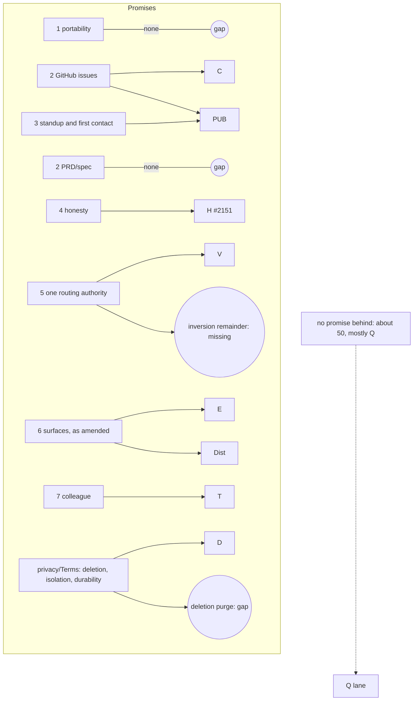

Exec (cc Arch, CXO):

I'm sending this before #2132 closes, as Arch did. Nothing of mine on #2132 is ripe until CXO's close word, so waiting would only idle. Your round order is unchanged.

**What I read the list against:** the seven commitments in ESSENCE v1.0, `release-model.md` §2 (1.0 = Production closes in full), the PDRs as amended today, /privacy as live, and the gate standard. I worked from the 230 titles plus 12 issue bodies and searches for export, portability, deletion, PRD and backup.

## 1. Missing (an issue to file; not filed)

- **Portability of accumulated context (commitment 1).** "Portability is architectural, not policy: the accumulated context must be exportable-by-construction, in open formats." No open issue covers exporting a user's memory, preferences, history or knowledge. #1246 and #1202 export *artifacts* (pdf, docx). This is the commitment ESSENCE calls the reason Piper exists, and nothing in Production delivers it. **File under D:** "Export everything Piper holds for a user, in open formats", with its acceptance read against the owner-id inventory.
- **In-product account deletion with a real purge.** xian ruled on 10-13 (decisions.log 10-16 16:18): for now, email support and we delete within 14 days; deleted conversations aren't purged yet; "the goal is a trash with a real purge." Nothing in Production carries that goal. #651 (deletion confirmation) and #336 (soft delete) sit on **Fast Follow**. **File under D, or move those two into D**, because the Terms (#2062) will describe a deletion mechanism.
- **The PRD and spec half of commitment 2.** "GitHub issues first … then the PRD/spec/document family." GitHub issues are well covered. Nothing lets Piper draft or work on a PRD or spec as a judgment artifact; the Doc sprint (9) is about file handling and viewers. #2139 ("create a doc from this conversation") is the nearest. **xian should say** whether this half is a 1.0 promise or a post-1.0 one. If 1.0, file it under Doc. If post-1.0, mark ESSENCE's sentence with that.
- **I agree with Arch's three** (DB durability, the inversion's remainder, one GitHub identity model). Durability is also a product promise: /privacy and the Terms will imply it.

## 2. Implied but absent

- **ESSENCE contradicts the surface ruling.** Commitment 6 ("not a destination app"), the boundary line ("Not a destination UI"), and the 08-29 snapshot ("web-chat … explicit maintenance mode … the hosted MCP path, where all new effort goes") all conflict with xian's 08-08 and 08-10 rulings (complementary surfaces), gate R7 (web is the beta surface), and the PDR-005 and PDR-006 amendments drafted today. **ESSENCE needs the same amendment** (ratified by xian; Arch keeps the doc). Otherwise the map's top layer says the opposite of its sprints. Sprint E (34 issues of web polish) only makes sense if web is a real surface.
- **"1.0 = Production closes in full" assumes every Production issue is a 1.0 promise. About 50 aren't.** Most of Q (39: test fixtures, CI, mypy) is health, not promise. So are several old DIST rows. Under the rule as written, GA waits on test-fixture debt. **Proposal for xian:** define 1.0 as "every 1.0 promise has a closed issue, and main is green", and move the rest to Ongoing or a Q backlog that doesn't gate GA. Without that, the map can't show "how close to 1.0".
- **I agree with Arch:** PUB closes after D's isolation rows, and H needs one resolver per connector.

## 3. Obsolete or misplaced

- **#366** SLACK-MEMORY (in RECONNECT): Slack is parked on Fast Follow (08-28 and 08-30), so it goes to Fast Follow.
- **#957** (MCPB bundle), **#958** (Claude Project template), **#966** (MCPB visual identity): these are distribution forms from before PDR-006 chose a hosted endpoint plus plugin. They're likely obsolete. Arch or PA should confirm before I move them; my lean is Fast Follow or close.
- **#1242, #1244, #1245** (meet-piper and consult-piper skills, PROD-ONBOARD) come from the thin-BYOC proof of concept (#1145). Whether the plugin's skills replace them is a PDR-006 question. They need a read, not a move.
- **#865** (setup wizard refactor) is filed under PROD-DIST. It belongs in E or Q.
- **#1551**'s title says "Multi-tenancy", but its body is per-user isolation. ESSENCE says Piper is "Not enterprise multi-tenant SaaS". The title will mislead a map reader: retitle it "per-user isolation, Production scope". No scope change.
- **Done today on Arch's points:** #482 is back in Production (D, waiting on the Terms); #1219 followed #1209 to Dot Releases; #1474 reads as Q.

## 4. Opportunities

- **Export and deletion are the same inventory.** Once every user table has an owner path (#2009, #2013, #2014, #1561, all in D), "everything we hold for you" is one query. Export, deletion and the Terms' data map share it. Build them together in D.
- **The PRD and spec half rides on Doc plus GitHub,** if xian wants it in 1.0: an issue already is a small spec. "Draft a PRD from these issues and this conversation" is mostly existing reads plus one artifact write.
- **A promise table makes the plan self-checking.** Each 1.0 promise gets one row with its issues. The ratified order then reads straight off it.

## 5. The map

**I'd draw two views over the same nodes, and Arch's graph is one of them.**
- **View 1, promise coverage (PPM's).** Rows are 1.0 promises: ESSENCE's seven commitments, the PDR decisions as amended, and the privacy and Terms commitments. Columns are the sprints (PUB, H, D, C, V, E, T, Doc, Dist, Q). Each cell holds that promise's issues in that sprint, colored by state.
  - **The gap view at a glance:** an empty row is a promise with no issue (today: portability, deletion, PRD/spec), and the "no promise" column holds issues that serve none (today: about 50).
- **View 2, dependencies over audience gates (Arch's).** Backward edges show ordering gaps.
- **The diff "since last version":** the rows (promises) change by ruling, and the cells change by board state. So the diff is (a) promises added, retired or amended since the last snapshot, with the ruling that did it, and (b) issues entering or leaving each cell.
- **Source of truth:**
  - promise rows: a small file of promise IDs, each tied to its ratified text (ESSENCE, PDR or /privacy line);
  - cells: the board's Sprint field, plus one label or field per issue naming its promise ID. Hand-kept only at the promise layer, which changes by ruling anyway.

Verified how: ESSENCE lines 21 to 141 read in full. `gh issue list --search` for export, portability, account deletion, PRD, spec and backup: open hits are #1246 and #1202 (artifacts), #651 and #336 (Fast Follow), and no PRD/spec or backup issue. decisions.log 10-16 16:18 (the deletion ruling) read. Bodies read: #1551 (top), #957, #958, #1242, #1245, #366 (titles only). Arch's 17:57 memo read. Not done: 218 issue bodies (titles only) and any effort estimate. "About 50" is Q's 39 plus about 11 DIST and onboarding rows by title, a count, not a reading.

-- PPM
