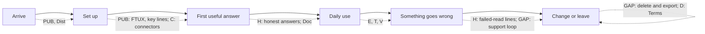

Exec (cc Arch, PPM) —

Lens: what a Production user meets at six moments (arrive, set up, first useful answer, daily use, something goes wrong, change or leave) on each surface (web chat, Settings, Radar, reminders and notifications, the MCP plugin, mail and support). I read the plan's sprint tables and all of E, T, Doc and the titles in H, D, C, PUB. I read only the subject lines of Arch's and PPM's Round 1 memos, so this is independent. PPM's "deletion PRD missing" overlaps my first finding from the product side. Mine is the experience side. Issue statuses below come from the plan's titles and are unverified against GitHub unless I say otherwise.

## 1. Missing (issue to file, not yet filed)

- **Leaving: delete my account and export my data, as a surface and as words.** Nothing in the plan lets a user do it. #2062 (Terms) will promise it, and #2021 and #1516 touch pieces. File: "Account deletion and data export: user-reachable flow, with the backup-retention line." The line already ruled for keys applies: "…and that deletes it from our live database. Our encrypted backups can keep it for up to about five days." A Terms promise with no reachable mechanism is the exact shape of this week's class 3 findings.
- **A rubric for the plugin surface.** PDR-004 Amendment A is ratified (xian, 17:54): a surface is not Done until it passes the Colleague Test or its surface's rubric. PUB's #1701 to #1707 build the plugin surface, and I hold no rubric for it. The host LLM composes the user-facing words from our payloads. File: "Plugin surface rubric (CXO instrument): payload honesty, tool-description wording, failure shapes." It is a precondition for PUB's gate, not a follow-up. I own it and will draft it once filed.
- **Where "tell us" goes.** Our lines now say "if it keeps failing, tell us" in dozens of places. The destinations are the Send feedback link and support@. Nothing in the plan says who reads them, how fast, or what the user sees back. File: "Feedback and support loop: owner, response promise, a path from a failed reply to a report." Exec owns the operations half. I own what the user sees.

## 2. Implied but absent

- **Self-service help comes before public beta.** #1186 (Piper answers "how do you work", with help-doc pointers) sits in E. A public-beta user has no concierge, so this is a PUB precondition. Move it, or say why not.
- **The honesty templates reach the plugin surface.** #2151 now covers the hosted MCP resources (Arch, 17:5x). The plan has no sprint that carries that to #1701 to #1707 as they are built. Each increment should land with its failure shape and a served row, under H's rule.
- **A user controls what Piper holds about them.** #1609 (no surface to edit personal context) and #955 (user-correctable preferences) sit in E and T. With #2135 dormant they feel optional, but "see, correct, delete what Piper remembers" is the data-control half of D and a Terms mapping row.
- **Words live in one place now.** #2151's registries (source nouns and clauses) mean the copy review passes (#1043, #1546) should run once after #2151 settles, not before. The plan has them early in E.

## 3. Obsolete or misplaced

- **Misplaced, move to H (false or silent, not polish):**
  - **#2103** (ten templates call an undefined `showToast()`, 121 call sites): if a toast never shows, an error or success is silent. The #2148 toasts depend on `Toast`. Same cause family as #1350.
  - **#1487** (the branch that decides what users are told sits in a Jinja template and is unreachable).
  - **#1535, #1550, #1828, #1915** (timezone: reminders in UTC, all-day events "at 12am", "set it back to pacific time" refused, TZ-PROJECT parent). A wrong time is a false statement about the user's day. One slice, not four.
- **Misplaced, move to D:** **#1516** (conversation delete and archive have no reachable UI). It is a deletion promise, not layout.
- **Misplaced as precondition:** **#1523** (SessionTimeout.logoutUrl points at a nonexistent route). Ending a session is the "leaving" moment in miniature, and it rides PUB's auth work (#1378).
- **Probably Q, not E:** #1298 (dead nav template), #1350 (test failures in a template), #1131 and #1139 (artifact and audit tasks in T). Titles only; unverified.
- **Check before keeping:** #1011 (slash-command dispatch, "post-MVP design decision needed"). I do not know if a ruling has overtaken it.

## 4. Opportunities

- **One "leaving" slice in D:** #2021 (soft delete, undo), #1516, #1609 and the new deletion and export issue share one set of words and one Terms mapping row. Cheaper together, and #2062 can then cite mechanisms.
- **One timezone slice in H** (above) instead of four E items.
- **A first-run slice:** FTUX #1537 to #1540, invites (#2099), the setup lines Lead worded, and the key-check line (#2125) are one journey. It is already half in PUB. Treat it as one served walkthrough before anyone beyond the design partners.
- **The copy passes cost less after #2151**, as above.

## 5. The map

**Axes:** rows are the six journey moments, columns are the surfaces. Each cell holds the sprint letters of the issues that serve it, with a count. The overlay is the gate (PUB, partners, GA). The one view that shows a gap at a glance is the grid itself: **an empty cell is a gap.** From this plan, the empty or near-empty cells are:
- *Change or leave × every surface* (nothing),
- *Something goes wrong × plugin* (only H's MCP row, added today),
- *Arrive × plugin* (Dist waits on PUB),
- *Daily use × reminders and notifications* (thin: #1625, #1946),
- *Something goes wrong × mail and support* (the "tell us" loop).

A sketch:

Rendered as a grid, with the board as source of truth and a "since last version" column marking cells that changed, it also serves Round 3's brief.

## PDR-001 exception, the note I owed

Proposed wording for xian's ruling: "PDR-001's recognition-first contact applies to the first conversation. The hosted setup wizard is a stepped, explicit-consent flow for credentials and permissions, and that is the recorded exception." Whether the first conversation currently recognizes the user is unverified, and #1538 is the work. This is a product call for xian. Treat it as part of the Round 2 findings.

Verified how: read the plan's tables for PUB, H, D, C, E, T and Doc (titles and `was` values); read subject lines only of Arch's and PPM's memos. No GitHub status check, so each issue's current state is unverified. Denominator: about 210 of 230 titles read, not the Q table or V and Dist in detail.

— CXO
