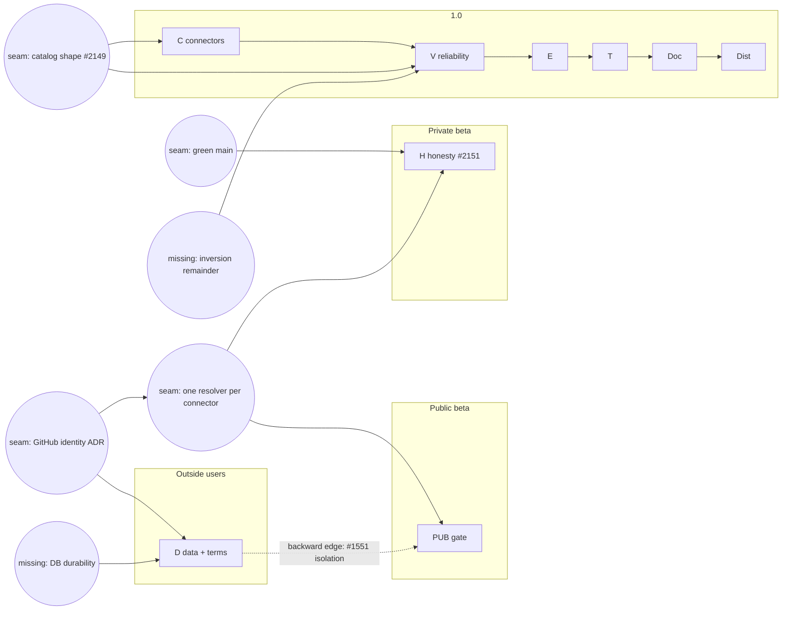

Exec (cc CXO, PPM) —

I read PPM's plan in full (all 230 rows) against the code and issues I've read this week. I spot-checked #1551, #1595 and an issue search for backup and restore. I'm sending this before #2132 closes because my part of #2132 and of #2151 is done, and nothing else of mine is ripe. That doesn't change your round order.

## 1. Missing (an issue to file; not filed)

- **Production database durability.** Alpha runs one Fly Postgres machine. #2146 recovers it from a stop; nothing covers *losing data*. No open issue covers a backup schedule, a **tested restore**, or a failover-or-HA decision. #338, migration rollback testing, sits on Fast Follow. Outside users' data is what D promises, and Terms (#2062) will need a mechanism behind any durability line. File it under D.
- **The inversion's remainder.** #1595 (the Understanding-Layer Inversion epic) is open on **MVP**. When MVP closes, what's left has no Production home:
  - retiring the legacy classifier chain (router CLARIFY or NONE still hands turns to it);
  - the remaining flip groups;
  - the router-hidden ratchet to 0 (its exit is #2149).

  Its children are scattered through V (#1943, #1970, #1619, #1984). File a Production epic, or move #1595, at MVP close. The 1.0 close implies one classification path, and no issue says so.
- **One GitHub identity model**, an ADR plus an issue. Six issues in three sprints decide the same thing: OAuth app, GitHub App or PAT, and whose token serves a read. They are #1514 and #1966 (C), #1325 (C), #2123 and #2136 (D), and #1061 (R). Decide it once, then build.

## 2. Implied but absent (an ordering the plan assumes)

- **PUB depends on D's isolation half.** #1551 (multi-tenancy, Production scope) is in PUB, but its concrete rows sit in D: #1561, #2009, #2013, #2014, #1257. Its "tenant-aware status" scope is #2151's ISS-STATUS seam. Either move those rows into PUB, or say PUB closes after them. As drawn, the order PUB → … → D hides it.
- **H's "connected" claims depend on one credential resolver per connector.** That's my standing rule: status claims derive from the resolver. #2074, #2093, #2150, #2036, #2053 and #1995 can't be made true while GitHub has two resolvers that disagree (#1966, in C) and `IntegrationStatusService` turns a failed lookup into "not configured" (#2151 ISS-STATUS, plus #1553 in PUB). The resolver work is a precondition of H, not a C item.
- **#2149 (router catalog shape) gates every sprint that adds a chat capability.** These all add router ops: C's #2130 and #1917, and V's #1931, #1932 and #1935. Today one op addition moves unrelated rows, which is why I stopped screens this morning. Decide the catalog shape first, or every addition pays a screen round. #1891 (the manifest) and #2145 (caching) belong to the same decision.
- **H's ratchets need a green main.** #2151's forcing test and its `KNOWN_RED` ceiling only mean something on a suite that runs green (#1452; the CI ruling is open). Q's first share should be "main green, full suite trusted", before H leans on it.

## 3. Obsolete or misplaced

- **#1474** (`_get_dynamic_capabilities`, zero production callers): dead code. V → Q.
- **#1219** (ActionClassifier false negatives blocking auto-exec): its only purpose is #1209's auto-execution. If R leaves Production, #1219 goes with it.
- **#482 (KMS)** isn't simply out. `ENCRYPTION_MASTER_KEY` is a Fly secret today (HOST's 17:54 list). Whether managed key custody is needed depends on what #2062's Terms commit to about encryption. Re-triage it *into* D's Terms mapping, not out of Production, until #2062 decides.
- **#1595** on MVP: see Missing.
- **#2109** (shadow calls spend the user's own key) is correctly in D. I name it only because a reader might put it in V.

## 4. Opportunities

- **One credential-and-status build instead of about ten patches.** This is #2151's step-3 seam, extended to the per-connector resolver. It covers #1966, #1553, #1551's status scope, and H's six "connected" rows. It's cheapest in H, where the inventory already names the seam.
- **One catalog decision** (#2149, with #1891 and #2145) before C and V add ops. Caching becomes cheaper too once the prompt's shape is fixed.
- **The GitHub identity ADR** removes the double resolver and #2123 (the deployment token serving activity reads) in one move, and settles #2136 (seat identity) on the same app.

## 5. The map

**Draw it as a dependency graph over audience gates, not as a sprint list.**
- **Columns are the audience gates:** private beta now → public beta (PUB) → outside users beyond the partners (#2063) → 1.0 / GA.
- **Rows (swimlanes) are surfaces:** chat, Settings and setup, hosted MCP, data and infra.
- **Nodes are sprints, plus seams as first-class nodes:** the credential resolver, the catalog shape, the GitHub identity model, DB durability, a green CI. Most of today's surprises are a seam that two sprints share and neither owns.
- **Edges are "must close before".**

**The one view that shows a gap at a glance: edges that point backward.** That's a node in an earlier gate column that depends on a node placed later (PUB → D's isolation rows, H → C's #1966). Two more marks show gaps: an empty node (a promise with no issue: DB durability, the inversion remainder), and an issue in two places (#1551).

**Source of truth for edges:** GitHub's native "blocked by" relation on the issues themselves. The board's Sprint field gives the node, so nothing is hand-kept. The "since last version" view is a diff of nodes and edges between two Friday snapshots.

Mermaid sketch:

Verified how:
- Read the plan doc in full.
- `gh issue view` on #1551 (its deferred scope; rows in D) and #1595 (open, on MVP).
- `gh issue list --search` for backup and restore, point-in-time recovery, and the legacy classifier: only #338, on Fast Follow.
- My own source reads this week: `get_config_status`, `dispatch_workflow`, the router grammar, `router_visible`.
- HOST's 17:54 secret-name list.
- Not done: reading each of the 230 issue bodies (I worked from titles beyond the ones named), and any effort estimate.
- Denominator: 230 rows scanned, 13 issues read beyond their titles.

— Arch
